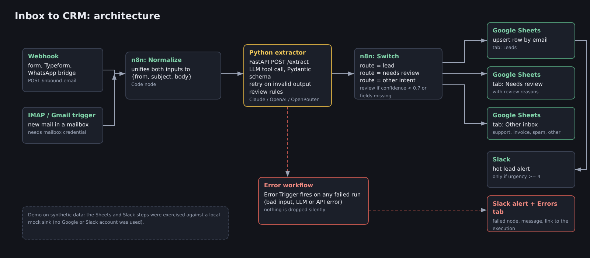
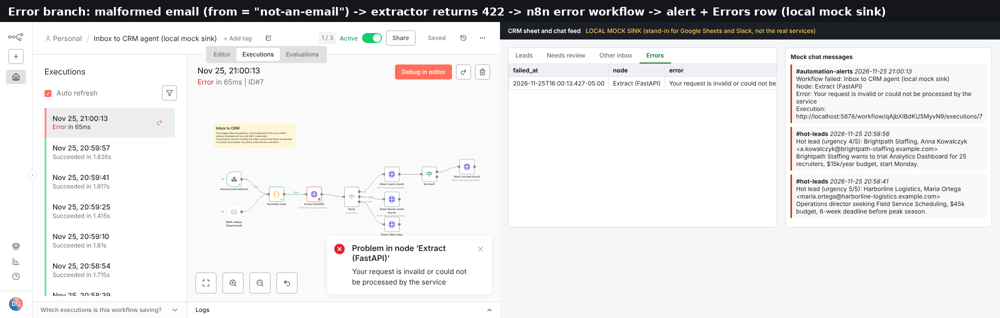
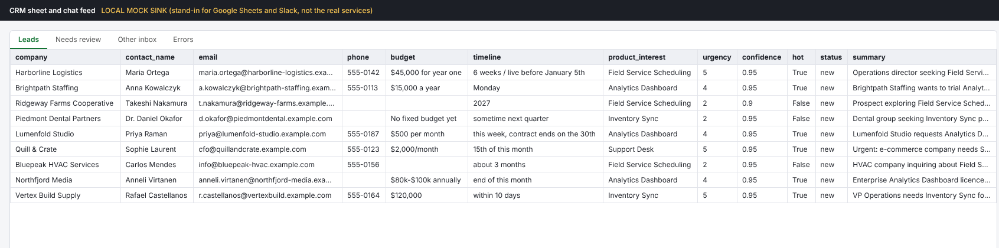

<p align="center"></p>

# inbox-to-crm-agent

An AI agent that reads your inbox, qualifies leads and updates your CRM automatically.


*Recorded with a local mock in place of Google Sheets and Slack; n8n, the extractor and the LLM calls are real.*

## The problem

Leads sit unread in shared inboxes, and copying them into the CRM by hand is slow and error-prone. Hot leads get noticed late, and support or invoice mail gets mixed in with them.

## How it works



1. **Trigger:** a webhook (form, Typeform, WhatsApp bridge) or an IMAP/Gmail mailbox delivers a message to n8n.
2. **Extract:** n8n calls the FastAPI service (`POST /extract`). It asks an LLM, through tool calling against a Pydantic schema, for the intent (`sales_lead`, `support`, `invoice`, `spam`, `other`) and the fields `company, contact_name, email, phone, budget, timeline, product_interest, urgency (1-5), summary`. Invalid output is retried with the validation error fed back.
3. **Validate:** business rules run on top of the schema. Confidence below 0.7, a malformed email, or a sales lead with no contact detail marks the email *needs review*.
4. **Route and write:** an n8n Switch sends leads to the `Leads` sheet tab (upsert by email), uncertain ones to `Needs review`, everything else to `Other inbox`.
5. **Alert and fail loudly:** sales leads with urgency >= 4 post a one-line Slack message. Any failing run (bad input, LLM or API error) triggers a separate error workflow that posts a Slack alert and logs a row in an `Errors` tab, so nothing is dropped silently.


The canvas above is the real exported workflow imported into n8n 1.123.0. The warning triangles are n8n telling you the Google Sheets and Slack nodes have no credentials yet: the export contains none.

## Results

Measured by `eval/run_eval.py` on 51 labelled synthetic emails (`eval/labels.csv`), temperature 0. The default model is Z.ai's free `glm-4.5-flash`; the Claude Haiku and GPT-4o-mini rows were measured through OpenRouter. Full tables, definitions and measurement dates: [`eval/results.md`](eval/results.md).

| Metric | `glm-4.5-flash` (default, Z.ai) | `claude-haiku-4.5` (OpenRouter) | `gpt-4o-mini` (OpenRouter) |
|---|---|---|---|
| Intent accuracy | 100.0% (51/51) | 100.0% (51/51) | 98.0% (50/51) |
| Field match, exact / fuzzy (237 labelled fields) | 85.2% / 95.8% | 85.2% / 94.5% | 83.5% / 91.6% |
| Fields filled where the label is empty (of 120) | 17 | 5 | 7 |
| Hot-lead alerts correct (of 10) | 8 | 10 | 10 |
| Routed to human review | 2.0% (1 of 51) | 3.9% (2 of 51) | 0.0% |
| Median / p95 latency per email | 4.87 s / 32.87 s | 1.91 s / 2.73 s | 2.43 s / 3.07 s |
| Cost per 100 emails | $0.000 (free tier) | $0.296 | $0.017 |

The free GLM model matches Haiku on intent and field match, but it fills more fields the email does not state (17 vs 5) and is weaker on urgency (52.9% exact vs 74.5%), so it caught 8 of 10 hot leads. Its p95 of 33 s comes from 7 calls that hit free-tier rate limits and waited for a retry. If missed hot leads cost more than $0.30 per 100 emails, switch to Haiku with one env var. Z.ai lists `glm-4.5-flash` as free on its [pricing page](https://docs.z.ai/guides/overview/pricing).

Limits: 51 emails is a small set (one email moves a percentage by about 2 points), and the emails are synthetic and labelled by the same author. Latency was measured sequentially, so treat it as indicative.

Reproduce: `python eval/run_eval.py --model zai:glm-4.5-flash --model openrouter:anthropic/claude-haiku-4.5 --model openrouter:openai/gpt-4o-mini` (needs `ZAI_API_KEY` and `OPENROUTER_API_KEY`; answers are cached in `eval/cache/`).

## Error branch

A malformed email (here `from: "not-an-email"`, sample `bad1`) is rejected by the extractor with HTTP 422. n8n marks the execution failed, the error workflow fires, and the failure shows up as a Slack alert and an `Errors` row (local mock sink in this screenshot).



Four malformed inputs live in `sample_data/invalid_emails.jsonl`; send them with `python scripts/send_samples.py --invalid`.

## Sheet result

The `Leads` tab after a run of synthetic emails (**local mock sink**, not Google Sheets):



## Run it

```bash
cp .env.example .env        # default LLM_PROVIDER=zai: set ZAI_API_KEY (free GLM Flash models)
docker compose up --build   # n8n on :5678, extractor on :8000 (override with N8N_PORT, EXTRACTOR_PORT)
```

Then:

1. Open http://localhost:5678, create the owner account, and import `n8n/error_workflow.json` first, then `n8n/workflow.json` (Workflows > Import from file). In the main workflow's settings, check that *Error workflow* points at "Inbox to CRM: error handler".
2. Add credentials (below), set your spreadsheet id and Slack channels in the Sheets/Slack nodes, and activate the workflow.
3. `python scripts/send_samples.py` posts the first 10 sample emails to the webhook (`--all` for all 51, `--invalid` for the error branch).

**Credentials setup (none are stored in this repo):**

- *LLM:* `LLM_PROVIDER=zai|openrouter|openai|anthropic` (default `zai`) plus `ZAI_API_KEY`, `OPENROUTER_API_KEY`, `OPENAI_API_KEY` or `ANTHROPIC_API_KEY` in `.env`. `LLM_MODEL` overrides the default (`glm-4.5-flash`, `anthropic/claude-haiku-4.5`, `gpt-4o-mini`, `claude-haiku-4-5`).
- *Google Sheets:* create a spreadsheet with tabs `Leads`, `Needs review`, `Other inbox`, `Errors`, header row matching the column names in the nodes, then add a Google Sheets credential in n8n.
- *Slack:* add a Slack credential and set the channels `#hot-leads` and `#automation-alerts`.
- *IMAP:* the IMAP node is shipped disabled. Add an IMAP credential and enable it to read a real mailbox.

Run the extractor without Docker: `cd extractor && pip install -r requirements.txt && uvicorn app:app --port 8000`. Tests: `pip install -r requirements-dev.txt && pytest`.

### Local mock sink (what the demo used)

`mock/mock_sinks.py` is a tiny service that accepts the same rows the Sheets nodes would write (upsert by email into SQLite) and Slack-style messages, and shows them on one page. `python scripts/build_workflows.py` also writes `n8n/demo-local-mock/`, a copy of the workflows with the Sheets and Slack nodes swapped for HTTP calls to it. It runs with `docker compose --profile mock up` or `uvicorn mock_sinks:app --port 9000` from `mock/`.

## What was and was not run

- **Run for real:** the extractor, the eval (Z.ai GLM and two models via OpenRouter), n8n 1.123.0 with both workflows imported, the webhook trigger, Switch routing, the hot-lead branch and the error workflow.
- **Mocked:** Google Sheets and Slack. The demo GIF, `sheet_result.png` and `error_branch.png` use the local mock sink; the real Sheets and Slack nodes are in the exported workflows but were never run against the live services.
- **Not exercised:** the native Anthropic and OpenAI SDK code paths (all measured runs went through OpenRouter or Z.ai) and the IMAP trigger (shipped disabled).
- **Docker:** `docker compose up --build` was tested: both services start and answer (`/health` returns ok, a malformed email gets 422, n8n serves its UI). This found that n8n needs `N8N_LISTEN_ADDRESS=0.0.0.0` on an IPv4-only container, which the compose file now sets.

## Adapt it to your business

- **Trigger:** swap the webhook/IMAP nodes for Gmail, Outlook, Typeform, a WhatsApp provider or any n8n trigger; only the *Normalize email* node needs to map the new payload to `{from, subject, body}`.
- **CRM:** replace the Google Sheets nodes with HubSpot, Pipedrive, GoHighLevel or Airtable nodes. The extractor output is already a flat record.
- **Model:** set `LLM_PROVIDER` and `LLM_MODEL`. Z.ai GLM, Claude, OpenAI and anything on OpenRouter work today; a Gemini or local-model provider is one function in `extractor/llm.py`.
- **Intents and fields:** edit `extractor/schema.py` and `extractor/prompts.py`, then re-run the eval.

## License

MIT. **Synthetic data only:** every company, person, address and phone number in `sample_data/` is fictional (`example.com` domains, `555-01xx` numbers).

Want this wired into your tools? Hire me on Upwork: https://www.upwork.com/freelancers/~014d8e815fea10ea82
